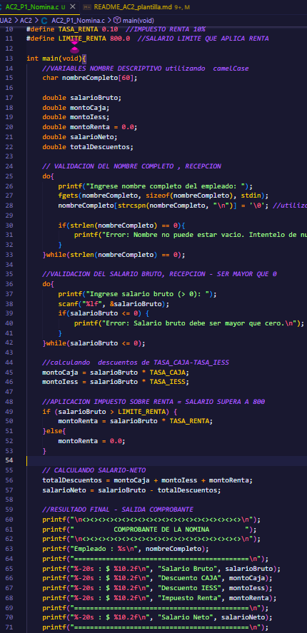
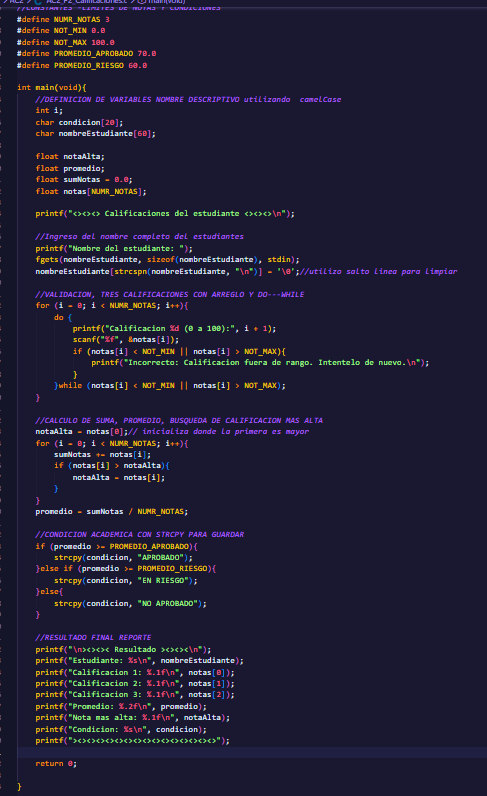

# AC2 · Mi primera aplicación en C

**Estudiante:** DAYANNA SANCHEZ JIMENEZ
**Fecha:** 20/10/2026  
**Módulo:** CSTI12010 Diseño de algoritmos· UA2

## Problema 1 · Nómina (AC2_P1_Nomina.c)

| Datos de entrada | Proceso | Datos de salida | Limitaciones |
|---|---|---|---|
| char_nombreCompleto del empleado.  double_numero_salario bruto. | strlen_validadcion nombre no este vacio   validacion mediante do_while salario >0. calculo deducciones CAJA 9.5%, IESS 2.5%.   Condicional aplicar impuesto de renta de(10%) si el salario bruto es mayor a 800.  Determinacion salario neto - las deducciones bruto. |Nombre del empleado.  Salario bruto con dos decimales.  Monto individual cada descuento CAJA, IESS, Renta.  Salario neto final. |El nombre no puede superar los 59 caracteres.  El salario debe ser numérico y mayor a cero.|

**Ejecución con los datos del ejemplo:**

## Problema 2 · Calificaciones (AC2_P2_Calificaciones.c)

| Datos de entrada | Proceso | Datos de salida | Limitaciones |
|---|---|---|---|
| char[]=Nombre completo del estudiante. Tres calificaciones numéricas -float- guardadas con arreglo de tamaño 3. |Lectura  de nombre con fgets.  Validación con do...while para asegurar que cada nota esté entre 0 y 100.  Recorrido con bucle for para sumar las notas y buscar la máxima.  Cálculo del promedio aritmético.  Evaluación de rangos para definir la condición institucional y asignación de texto usando strcpy.  |Nombre del estudiante.  Desglose de las tres calificaciones. Promedio general con dos decimales.  Calificación más alta.  Condición institucional APROBADO, EN RIESGO, NO APROBADO.  |Arreglo está limitado  a 3 calificaciones.  Las notas deben ser valores reales válidos en el rango permitido.  |

**Ejecución con los datos del ejemplo:**

## Problema 3 · Compras (AC2_P3_Compras.c)

| Datos de entrada | Proceso | Datos de salida | Limitaciones |
|---|---|---|---|
| Nombre del cliente, nombre de producto, precio unitario, cantidad y opción de continuar (S/N). |Registro mediante arreglos paralelos.  Validación de datos positivos con do...while.  Cálculo de subtotales y aplicación de descuentos por rangos.  Cálculo de impuesto del 13% y total a pagar. |Factura detallada con listado de productos, subtotal, descuento, impuesto y total final. | Máximo de 10 productos por compra.  Precios y cantidades  mayores a cero. |

**Ejecución con los datos del ejemplo:**

## Conclusión

(Qué aprendí y qué fue lo más difícil de pasar de PSeInt a C.)

¿Qué aprendí? A traducir algoritmos a C (variables, arreglos y cadenas) organizando el tiempo por fases y usando gcc (-Wall -Wextra) para verificar errores de forma efectiva.

¿Qué fue lo más difícil? Adaptarme a la sintaxis estricta, evitar confusiones entre = y ==, y dominar el búfer de entrada con scanf y fgets.

Próximos pasos: Seguir aprendiendo mas los temas avanzados y seguir cumpliendo correctamente.
